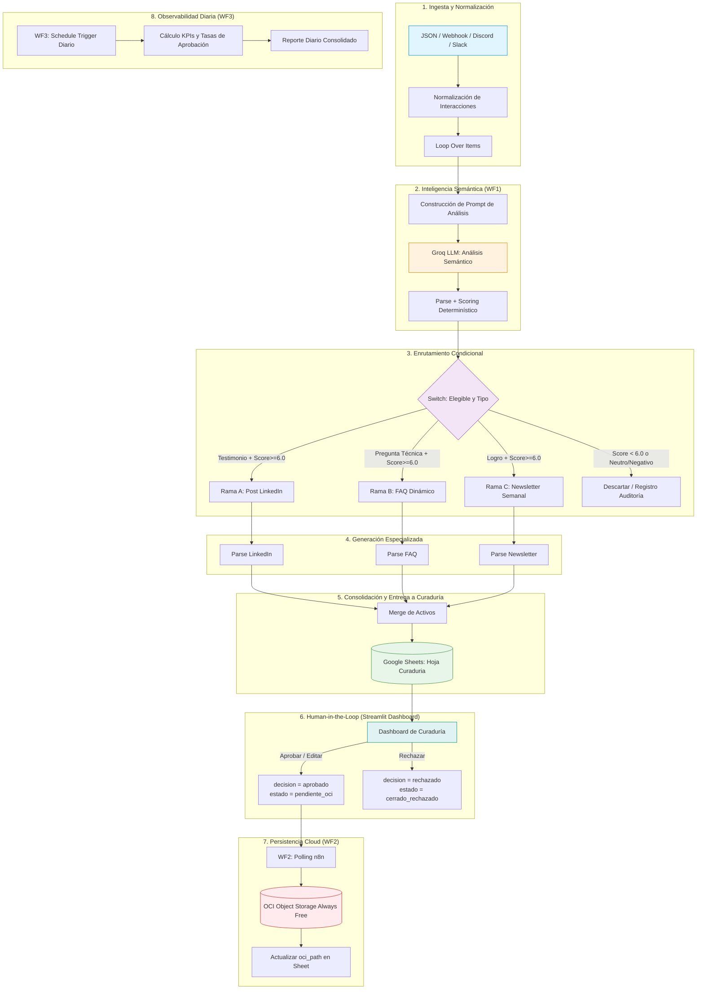

# 🛡️ CommunityLab
### Motor Inteligente de Transformación y Distribución para Comunidades Digitales

> **Hackathon ONE G10 · Oracle Next Education & Alura · Octubre 2026**  
> **Equipo 36**  
> *"La IA propone · El humano decide · OCI guarda solo lo aprobado."*

---

## 📌 ¿Qué es CommunityLab?

**CommunityLab** transforma la actividad orgánica de una comunidad digital (testimonios, dudas, logros dispersos en canales como Discord) en activos de marketing listos para distribución — de forma automatizada, con curación humana obligatoria y persistencia en la nube de Oracle.

---

## 🎯 Justificación y Propuesta de Valor

### El Problema
Las comunidades de aprendizaje tecnológico, plataformas SaaS y ecosistemas de desarrolladores (como Discord, Slack, foros y GitHub) generan diariamente decenas de interacciones orgánicas de alto valor: testimonios de empleo, dudas técnicas recurrentes, proyectos destacados y feedback constructivo. Sin embargo, **más del 90% de este valor se desaprovecha** debido a que la recolección, selección, curaduría y adaptación a formatos de marketing requiere horas de trabajo manual de los equipos de Community Management.

### La Solución
**CommunityLab** implementa una arquitectura orientada a eventos con IA Generativa y orquestación que:
1. **Ingiere y normaliza** interacciones comunitarias en tiempo real y por lotes.
2. **Evalúa semánticamente** los mensajes con modelos LLM ultrarrápidos (Groq Llama 3) y aplica un algoritmo de scoring determinístico ponderado.
3. **Bifurca y genera automáticamente** 3 formatos especializados de contenido:
   - 📢 **Post de LinkedIn** para visibilizar testimonios de éxito profesional.
   - 💡 **Preguntas Frecuentes (FAQ / Guía Técnica)** para capitalizar soluciones a problemas recurrentes.
   - 📰 **Destaque de Newsletter Semanal** para amplificar logros y proyectos comunitarios.
4. **Incorpora curaduría humana (*Human-in-the-Loop*)** mediante un dashboard interactivo en Streamlit conectado con Google Sheets.
5. **Garantiza persistencia enterprise** en **Oracle Cloud Infrastructure (OCI Object Storage Always Free)** únicamente para los activos aprobados.
6. **Genera métricas y analítica diaria** para monitorear el pulso y la salud del ecosistema.

---

## 🏛️ Arquitectura del Sistema



---

## 📂 Estructura del Proyecto

```text
communitylab/
├── README.md                                 # Documentación principal del proyecto
├── .gitignore                                # Exclusiones de Git (entornos, secretos, caches)
├── workflows/                                # Definiciones exportadas de n8n
│   ├── WF1-ingesta-analisis-generacion.json  # Flujo 1: Ingesta, análisis LLM y generación
│   ├── WF2-curaduria-oci.json                # Flujo 2: Lectura de aprobados y subida a OCI
│   └── WF3-metricas-diarias.json             # Flujo 3: Cálculo y consolidación de métricas
├── dashboard/                                # Aplicación de Curaduría Humana
│   ├── dashboard_curaduria.py                # Interfaz en Streamlit (Human-in-the-Loop)
│   ├── requirements.txt                      # Dependencias de Python
│   └── README-dashboard.md                   # Guía de configuración y uso del dashboard
└── docs/
    └── capturas/                             # Evidencias visuales y diagramas
```

---

## ⚙️ Workflows de Automatización (n8n)

### 1. `WF1-ingesta-analisis-generacion.json`
- **Disparador:** Webhook HTTP (`POST /webhook/communitylab-ingesta`) o ejecución manual con dataset de prueba.
- **Normalización:** Homogeneiza autores, canales, tipos de interacción y marcas de tiempo UTC con identificador de ejecución único (`CL-YYYYMMDD-XXX`).
- **Análisis Semántico con Groq:** Evalúa sentimiento (`muy_positivo`, `positivo`, `neutro`, `negativo`), extrae temáticas y produce una calificación base.
- **Scoring Determinístico:** Fórmula ponderada que premia la afinidad temática, sentimiento positivo y profundidad del contenido.
- **Bifurcación:** Enrutamiento hacia tres generadores LLM con system prompts diseñados para cada canal (LinkedIn con hashtags y ganchos, FAQ estructurado en problema/solución, Newsletter con formato de historia).
- **Publicación:** Registra los activos generados en Google Sheets en estado `pendiente_curaduria`.

### 2. `WF2-curaduria-oci.json`
- **Disparador:** Temporizador de intervalo (ejecución periódica cada 15 minutos).
- **Filtro Estricto:** Selecciona únicamente las filas con `decision = aprobado` y `estado_proceso = pendiente_oci`.
- **Integración con OCI:** Realiza llamada REST API autenticada mediante Request Signing hacia el bucket de **OCI Object Storage Always Free**.
- **Convención de Objetos en OCI:**
  ```text
  activos/{periodo_referencia}/{execution_id}/{asset_id}.json
  ```
- **Cierre de Ciclo:** Actualiza la fila en Google Sheets con `estado_proceso = almacenado_oci` y la URL pública/ruta del objeto persistido.

### 3. `WF3-metricas-diarias.json`
- **Disparador:** Schedule Trigger diario a las 00:00 UTC.
- **Extracción y Agregación:** Lee el historial de interacciones y decisiones de curaduría.
- **Métricas Calculadas:**
  - Volumen diario de interacciones procesadas.
  - Distribución de sentimiento y canales más activos.
  - Tasa de aprobación humana vs. rechazo.
  - Total de activos guardados en OCI Object Storage.

---

## 🖥️ Módulo de Curaduría (Dashboard Streamlit)

El archivo [`dashboard/dashboard_curaduria.py`](dashboard/dashboard_curaduria.py) implementa la estación de control para el equipo de marketing:
- **Visualización Limpia:** Tabla interactiva con filtros por canal, tipo y score.
- **Edición en Línea:** El curador puede afinar el texto generado por la IA antes de aprobarlo.
- **Auditoría Dual:** Al editar, `contenido` almacena la versión editada y `contenido_json` preserva la versión pura del LLM para trazabilidad.
- **Seguridad Anticolisión:** Indexación por número de fila física en el Sheet para evitar sobreescritura cuando los `asset_id` coinciden entre ejecuciones.

Consulta la guía detallada en [`dashboard/README-dashboard.md`](dashboard/README-dashboard.md).

---

## 📑 Acuerdos y Contratos de Datos (Data Contracts)

### Entrada al Pipeline (Trigger):
```json
{
  "origen_comunidad": "Discord_Grupo_ONE_G10",
  "periodo_referencia": "Semana_04",
  "interacciones": [
    {
      "autor": "Mariana Souza",
      "canal": "#logros-y-empleos",
      "tipo": "testimonio",
      "texto": "Después de 8 meses aplicando lo que aprendí en el programa, firmé mi primera oferta como desarrolladora junior."
    }
  ]
}
```

### Salida del Análisis Semántico (LLM):
```json
{
  "sentimiento": "muy_positivo",
  "temas": ["empleo", "desarrollo", "carrera"],
  "tipo_detectado": "testimonio",
  "score_llm": 9.5,
  "insight": "Historia de inserción laboral con alta resonancia comunitaria"
}
```

### Registro de Persistencia en OCI:
```json
{
  "bucket": "communitylab-activos-marketing",
  "ruta_objeto": "activos/Semana_04/CL-20261014-452/asset-001.json",
  "status": "guardado_con_exito",
  "timestamp": "2026-10-14T18:00:00Z"
}
```

---

## 🚀 Guía de Despliegue Rápido

### 1. Despliegue de Workflows en n8n
1. Abre tu instancia de n8n.
2. Ve a **Workflows** → **Import from File**.
3. Importa sucesivamente:
   - `workflows/WF1-ingesta-analisis-generacion.json`
   - `workflows/WF2-curaduria-oci.json`
   - `workflows/WF3-metricas-diarias.json`
4. Configura las credenciales:
   - **Groq API**: Header Auth (`Authorization: Bearer <TU_GROQ_API_KEY>`).
   - **Google Sheets API**: OAuth2 o Service Account.
   - **Oracle Cloud (OCI)**: Credenciales REST o clave privada para Object Storage.

### 2. Despliegue del Dashboard
```bash
cd dashboard
python -m venv venv
# Activar entorno virtual según tu SO
pip install -r requirements.txt
# Crear .streamlit/secrets.toml con las credenciales de GCP
streamlit run dashboard_curaduria.py
```

---

## 🏆 Matriz de Cumplimiento de Criterios de Evaluación

| Criterio del Hackathon ONE | Estado | Evidencia en el Repositorio |
| :--- | :---: | :--- |
| **1. Ingestión funcional de interacciones** | ✅ Cumplido | Nodo Webhook y Normalización en `WF1-ingesta-analisis-generacion.json`. |
| **2. Análisis de sentimiento y extracción con LLM** | ✅ Cumplido | Prompt estructurado y parsing estricto JSON con Groq en WF1. |
| **3. Generación de ≥ 2 formatos de marketing** | ✅ Cumplido | **3 formatos generados:** LinkedIn, FAQ estructurado y Newsletter. |
| **4. Orquestación del flujo en n8n** | ✅ Cumplido | 3 workflows modulares e interconectados (`workflows/`). |
| **5. Persistencia en OCI Object Storage Always Free** | ✅ Cumplido | Flujo `WF2-curaduria-oci.json` con subida automatizada y verificación. |
| **6. Demostración de ≥ 3 ejemplos de transformación** | ✅ Cumplido | Dataset de validación incluido cubriendo las 3 ramas y caso de descarte. |
| **7. Documentación y diagrama del pipeline** | ✅ Cumplido | Diagrama de flujo Mermaid, contratos de datos y guías de despliegue. |
| **Diferencial: Curaduría Humana (Human-in-the-Loop)** | ✅ Cumplido | Aplicación web en Streamlit integrada con Google Sheets y WF2. |
| **Diferencial: Observabilidad y Métricas** | ✅ Cumplido | Flujo `WF3-metricas-diarias.json` para monitoreo continuo. |

---

## 👥 Equipo 36
- **Proyecto:** CommunityLab
- **Repositorio Oficial:** [GitHub - Proyecto-Equipo-36](https://github.com/FerIqm1993/Proyecto-Equipo-36.git)
- **Hackathon:** Oracle Next Education & Alura — Edición G10
